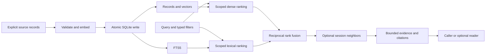

# one-mem Implementation Plan

> **For agentic workers:** Use `superpowers:subagent-driven-development` or `superpowers:executing-plans` when implementing this plan. Complete one independently verifiable task at a time. Checkboxes are execution tracking, not claims of existing functionality.

**Goal:** Build a small TypeScript memory library that returns durable, source-bearing evidence through hybrid retrieval and bounded conversational context.

**Architecture:** Keep one SQLite connection behind a narrow library API. Maintain original records, embeddings, and FTS5 in atomic transactions; combine dense and lexical ranks, then optionally expand neighbors using explicit session order. Require an injected embedding provider and keep final answer generation separate.

**Tech stack:** Strict TypeScript ESM, Bun for development, `tsc`, Node-compatible standard libraries, one locally verified `better-sqlite3` driver, sqlite-vec, SQLite FTS5, and `node:test`/`node:assert/strict`.

**Spec:** [PAPER_ANALYSIS.md](PAPER_ANALYSIS.md), [REFERENCE_ANALYSIS.md](REFERENCE_ANALYSIS.md), [ARCHITECTURE.md](ARCHITECTURE.md), and accepted constraints in [DECISIONS.md](DECISIONS.md). This is an independently designed implementation, not a fidelity target for the paper or Python reference. The paper combines entity propagation/PPR, hierarchical retrieval, query-dependent score fusion, closure, and calibration; dense + FTS5 rank fusion with neighbors implements only the proposed baseline.

## Constraints and recommendations

**Existing constraints:** Node.js 22+; Bun 1.4+; strict TypeScript ES modules; two-space indentation; Bun-managed lockfile; source in `src/`; build output in `dist/`; tests in `tests/*.test.ts`. Windows x64, Linux, and macOS are targets. Windows ARM64 is out of scope. Keep one package, initially private. Do not copy reference code, prompts, datasets, or model files. Public documentation is English; user-facing conversation is Vietnamese. Use Conventional Commits, short `type/description` branches, and no co-author trailers.

**Recommended choices, not additional user requirements:** one namespace and one embedding space per database; caller-supplied embedding provider; FTS5 + dense reciprocal rank fusion; source/session neighbor expansion; no default NER, graph, hierarchy, reranker, reader SDK, server, or CLI.

The user asked to learn implementation ideas and recommend better-fitting options. Phase 0 settles the remaining storage choices with evidence; the later experiments have promotion gates rather than an obligation to reproduce reference subsystems.

**Confirmed evaluation sizes:** the user selected 10,000 and 100,000 records as the initial comparison points because production volume is not yet known. These are benchmark workloads, not supported-capacity guarantees.

| Choice | Initial recommendation | Cost / alternative |
| --- | --- | --- |
| Driver | Shared `better-sqlite3` | Already works in a local two-runtime probe; dual drivers remain a fallback if platform tests fail |
| Vector layout | Inline BLOB + scalar cosine initially | Local results favor `vec0` for broad scans and indexed scalar queries for selective filters; choose against the expected workload before freezing storage |
| Isolation | One namespace per DB | Separate FTS statistics and simpler configuration; more files and no cross-namespace query |
| Embeddings | Required injected provider | Caller owns model access, credentials, retries, batching, and privacy; no turnkey model download |
| Offline model | Optional later integration | Useful offline, but model assets, tokenizer/pooling parity, native/WASM support, and package size must be measured |
| Remote model | Caller adapter initially | Small library; network availability, latency, cost, data transfer, and model revision remain caller responsibilities |
| Retrieval | Fixed equal-weight rank fusion | Avoids incomparable BM25/cosine scales; weights/reranker only after held-out evaluation |
| Context | Same-source/session neighbors | Cheap and source-preserving; cannot recover distant topic relationships by itself |



## Proposed public contract

This is the final initial-library contract. Introduce each export/option only with its implemented phase; Phase 1 omits `search`, and Phase 2 omits the `neighbors` option until Phase 3. Reject an unsupported option received from JavaScript at runtime instead of ignoring it.
The namespace is owned by the database, not inferred from text or a query.
`sourceId` identifies a document or conversation; `id` identifies one caller-defined atomic record within the namespace.
IDs represent observations, not mutable entity/fact slots. Add a new ID for a later factual statement or event so earlier evidence survives; reserve `upsert` for explicit correction/replacement of that same source record. The initial library retains no revision history and does not rewrite conflicting statements into a latest-wins fact.
For conversational context, provide one real turn per record plus `sessionId` and `sequence`.
Large-document chunking belongs to the caller initially; this library does not guess chunk or speaker boundaries.
"Original text" means the exact supplied record. Callers that chunk or compress an upstream document remain responsible for retaining its uncompressed original and mapping record IDs to immutable source revisions and spans. Any future built-in chunking, graph mentions, extractive evidence, or hierarchy units must specify offset units and retain exact source-record/revision/span mappings; no generated summary replaces the authoritative originals.

```ts
export interface EmbeddingSpace {
  id: string; // Includes model revision, pooling and preprocessing identity.
  dimensions: number; // Library bound: safe integer 1..8192.
  metric: "cosine";
}
export interface EmbeddingProvider {
  space: EmbeddingSpace;
  embed(texts: readonly string[], options: {
    purpose: "document" | "query";
    signal?: AbortSignal;
  }): Promise<readonly Float32Array[]>;
}
export interface MemoryInput {
  id: string;
  sourceId: string;
  text: string;
  sessionId?: string;
  sequence?: number;
  speaker?: string;
  observedAt?: string; // ISO instant with explicit offset; stored as UTC.
  eventAt?: string; // Only explicit caller data; never inferred from observedAt.
}
export interface MemoryRecord extends MemoryInput {
  revision: string; // Opaque UUID; changes on any content/metadata change.
}
export interface Scope {
  sourceId?: string;
  sessionId?: string; // Requires sourceId.
}
export interface SearchOptions extends Scope {
  limit?: number; // Default 10, integer 1..100 matched records.
  neighbors?: number; // Default 0; radius 0..2 on each side.
  maxEvidenceBytes?: number; // Default 16_384; safe integer >= 0, UTF-8 text bytes.
  signal?: AbortSignal;
}
export interface EvidenceItem {
  record: MemoryRecord;
  role: "match" | "context";
  score: number | null; // RRF for matches; null for added context.
  ranks: { dense?: number; lexical?: number };
  anchorIds: readonly string[]; // Matches that requested this neighbor.
}
export interface Evidence {
  namespace: string;
  query: string;
  embeddingSpace: EmbeddingSpace;
  items: readonly EvidenceItem[];
  diagnostics: {
    denseCandidates: number;
    lexicalCandidates: number;
    lexicalTermsUsed: number;
    lexicalTermsTruncated: boolean;
    usedBytes: number;
    budgetOmitted: number;
  };
}
export interface UpsertResult {
  records: readonly { id: string; revision: string;
    status: "inserted" | "updated" | "unchanged" }[];
}
export interface Memory {
  upsert(records: readonly MemoryInput[], options?: {
    signal?: AbortSignal;
  }): Promise<UpsertResult>;
  get(id: string): Promise<MemoryRecord | undefined>;
  remove(ids: readonly string[]): Promise<number>;
  search(query: string, options?: SearchOptions): Promise<Evidence>;
  close(): Promise<void>;
}
export declare function openMemory(options: {
  path: string;
  namespace: string;
  embeddings: EmbeddingProvider;
}): Promise<Memory>;
```

**Contract rules.** Preserve original text and identifiers exactly; reject blank IDs/source IDs/text, blank supplied session IDs, duplicate IDs within an upsert batch, invalid timestamps, unsafe/noninteger/negative sequences, or a session without a sequence (and vice versa). `sessionId` filters require `sourceId`. `(sourceId, sessionId, sequence)` is unique for session records. `speaker` alone does not create a session. Validate `limit`, `neighbors`, and `maxEvidenceBytes` as safe integers within their stated ranges. Reject unsupported options rather than silently guessing.

Provider output must contain exactly one vector per input, in order, with the declared dimension. Validate finite components and nonzero norm after Float32 conversion, normalize once, validate the normalized Float32 output again, and encode little-endian bytes. NaN/Infinity/zero vectors can pass SQLite dimension checks yet yield NULL cosine distance, which sorts first ascending. Record count, space ID, dimensions, and metric are checked before writing or querying. At open, validate a nonempty space ID and safe-integer dimensions in `1..8192`; 8192 is an explicit initial library limit, with local scalar cosine execution checked at that bound in both runtimes, not a claim about every extension build. Copy/freeze the space descriptor, compare it with persisted settings, and reject later descriptor mutation before provider calls. Do not keep a mutable caller object as the database contract. A model name without a stable preprocessing/revision identity is insufficient. Providers must honor the document/query purpose, keep implementation semantics stable under that space ID, and disclose any remote processing to their caller.

The core never initiates generative calls. Embedding requests can still incur cost; an injected provider that performs hidden generative preprocessing falls outside the paper's zero-token regime, and the core cannot certify arbitrary provider internals. Provider failures propagate with their cause; no automatic retry, fallback model, or partial success. Deterministic test providers do not establish real-model quality.

Use a small `MemoryError` with codes `INVALID_INPUT`, `EMBEDDING_MISMATCH`, `PROVIDER_FAILURE`, `DATABASE_MISMATCH`, `UNSUPPORTED_SCHEMA`, `CONFLICT`, `SQLITE_UNAVAILABLE`, `BUSY`, and `CLOSED`. Preserve causes without logging records, queries, credentials, or provider payloads by default. Operational SQLite corruption/I/O errors retain their original cause; do not disguise them as empty retrieval results.

## Storage and lifecycle contract

Use the following inline-BLOB baseline unless Phase 0's realistic-corpus verification exposes a material latency problem. The `vec0` alternative moves the embedding into a dedicated virtual table keyed by the ordinary record's integer key. Do not keep both as authoritative vector stores.

```sql
CREATE TABLE settings (key TEXT PRIMARY KEY, value TEXT NOT NULL) STRICT;
CREATE TABLE records (
  row_id INTEGER PRIMARY KEY,
  id TEXT NOT NULL UNIQUE,
  source_id TEXT NOT NULL,
  text TEXT NOT NULL,
  session_id TEXT,
  sequence INTEGER,
  speaker TEXT,
  observed_at TEXT,
  event_at TEXT,
  revision TEXT NOT NULL,
  content_hash TEXT NOT NULL,
  embedding BLOB NOT NULL CHECK(length(embedding) > 0 AND length(embedding) % 4 = 0),
  CHECK ((session_id IS NULL AND sequence IS NULL) OR
         (session_id IS NOT NULL AND sequence IS NOT NULL AND sequence >= 0)),
  UNIQUE(source_id, session_id, sequence)
) STRICT;
CREATE INDEX records_session ON records(source_id, session_id, sequence);
CREATE VIRTUAL TABLE records_fts USING fts5(
  text, content='records', content_rowid='row_id',
  tokenize='unicode61 remove_diacritics 0'
);
```

Store namespace, embedding-space ID/dimension/metric, and vector encoding (`float32-le-normalized`) in `settings`; use `PRAGMA user_version` for schema migrations. Validate each vector's exact length against those settings; the SQL byte-shape check is only a second guard. Keep internal SQLite keys as bigint and validate any integer converted to a public JavaScript number. Enable foreign keys and a documented busy timeout on every connection. WAL is for local file databases, not a network-filesystem support claim. A missing parent path or unwritable database returns the underlying actionable error; no implicit directory tree creation.

FTS5 external-content maintenance requires insert/delete/update triggers. Deletion uses the FTS5 special delete command with the old row key and text. Create triggers and rebuild existing FTS content within the migration transaction. If `vec0` wins, mirror each record insertion/replacement/deletion in the same transaction and address the virtual table's declared primary key, not an assumed `rowid` alias.

For scalar search, use `vec_distance_cosine(embedding, ?)` on filtered record rows and sort distance ascending, then caller ID with binary collation. Cost is O(N × dimensions) over the filtered corpus; no ANN or sublinear latency claim. For `vec0`, prove source/session constraints apply before its nearest-neighbor limit; do not fetch global top-k and filter afterward. Its KNN restrictions include primary-key binding and sorting: bind named integer keys as bigint, and use a validated outer sort rather than assuming `ORDER BY distance, id` is accepted inside KNN. A tie at its candidate cutoff also needs a specified/tested policy before claiming the scalar path's deterministic ties.

**Upsert:** normalize/validate the entire input; read affected existing records; hash UTF-8 `JSON.stringify([id, sourceId, text, sessionId ?? null, sequence ?? null, speaker ?? null, observedAt ?? null, eventAt ?? null])` using SHA-256, after canonicalizing supplied instants to UTC ISO strings. Field order is fixed; absent optional values become null; original text/identifiers are not trimmed. Skip unchanged records; embed new/changed text outside any SQL transaction. Reuse an existing vector for metadata-only changes in the same embedding space. After all outputs validate, enter one synchronous transaction, verify affected revisions still match the read snapshot, and apply all replacements plus FTS/vector changes. On a conflicting write, throw `CONFLICT` with no partial commit; do not repeat paid provider calls automatically.

Delete changed records and insert their complete replacements inside the transaction if necessary to support swapping two session ordinals without transient uniqueness failures. Internal row keys may change; they never appear in public citations. New revisions use `crypto.randomUUID()`, so deleting/reinserting an ID cannot make old citations resolve to unrelated content. Unchanged canonical input preserves its revision. Revisions are identifiers, not numeric order or wall-clock timestamps.

**Remove:** delete only requested caller IDs; deduplicate the ID list; return the number actually removed. Missing IDs are harmless. Original rows, vector rows if separate, and FTS entries disappear atomically. This is logical deletion, not guaranteed physical erasure from WAL, backups, or storage media.

**Consistency:** serialize operations on one `Memory` handle. Embedding awaits do not hold database locks. Revision checks protect read/prepare/write races across handles. Search embeds its query first, then materializes both branch candidates, records, and neighbors within one synchronous read transaction. Returned evidence is a snapshot; later updates do not mutate it. `get` plus a revision comparison verifies whether a citation is still current; historical content is not retained.

**Close:** stop accepting new operations, wait for accepted operations, close once, and allow repeated `close()`. Subsequent operations throw `CLOSED`. Cancellation before commit changes nothing; a commit that already completed remains committed. A provider that ignores its signal cannot be forcibly stopped by the library.

**Migrations/backfill:** version 1 creates storage and metadata atomically; reject newer versions without modifying the DB. Future SQL migrations run under an exclusive migration transaction, with backup/restore instructions and old-version fixtures. FTS tokenizer/schema changes rebuild FTS from original text. Changing model ID, dimension, preprocessing, normalization, or metric requires building a new database from original records, verifying it, then explicitly switching paths; never silently mix or re-embed an existing database on open. A replacement database may assign new revisions; citations always include its namespace plus record/revision identity.

## Ranking and context behavior

1. Validate query/options. Empty query is invalid. Empty corpus returns empty evidence without provider inference.
2. Embed the query; validate and normalize it under the database's stored embedding space.
3. Retrieve up to `min(500, max(50, 5 * limit))` candidates from each branch, with source/session filters applied **before** ranking limits.
4. Compile lexical input into up to 32 distinct Unicode letter/number/underscore tokens; quote each as a literal FTS phrase and join with `OR`. Never pass raw query syntax to `MATCH`. Report term truncation. Punctuation-only input has no lexical candidates but may use dense retrieval.
5. Order dense cosine distance ascending and FTS5 `bm25(records_fts)` ascending; break ties by caller ID. FTS5's negative/lower-is-better values must not be added to cosine scores.
6. Assign one-based ranks. Merge record IDs with `RRF(id) = Σ 1 / (60 + branchRank(id))`, then sort score descending, ID ascending. A missing lexical hit contributes zero, not an invented rank. Return ranks for auditability.
7. Select whole matched records in fused order until `limit` fits the evidence byte budget; skip an oversized record and continue. Never truncate a record silently. Deduplicate by ID, not text, so independent sources survive.
8. If requested, expand each selected match by up to `neighbors` consecutive ordinals before/after it in the exact same source/session. Stop at ordinal gaps and session edges. Records without session/order receive no neighbors. Do not cross source boundaries, sort by timestamp, or infer relative dates.
9. Append fitting context in anchor-rank, then sequence, then ID order. Keep each record once; a match stays a match. Merge `anchorIds` for shared context. Context has no invented relevance score. Matches have budget priority.
10. `usedBytes` equals the sum of `TextEncoder().encode(record.text).byteLength` for returned records, including repeated text from distinct IDs. It never exceeds `maxEvidenceBytes`. Metadata, query, prompt syntax, and model tokens are outside this explicitly named budget.

Use `remove_diacritics 0` initially to preserve accents; FTS5 Unicode tokenization is not a complete Vietnamese word segmenter or code-symbol analyzer. Tests and held-out language slices decide whether a tokenizer change is warranted.

## File ownership and implementation sequence

| File | First responsibility | Phase |
| --- | --- | --- |
| `src/index.ts`, `src/types.ts`, `src/errors.ts` | Public exports/contracts | 1 |
| `src/storage.ts` | Shared driver, migration, concrete SQL operations | 0–1 |
| `src/embeddings.ts` | Provider validation and vector encoding | 1 |
| `src/memory.ts` | Lifecycle, upsert/remove/search coordination | 1–2 |
| `src/retrieval.ts` | Lexical query compiler, branch ranks, RRF | 2 |
| `src/evidence.ts` | Whole-record byte budget; source/session neighbors added next | 2–3 |
| `tests/fixtures.ts` | Independently authored records/vectors | 0 |
| `tests/*.test.ts` | Native storage and behavioral tests | Every phase |
| `tsconfig.test.json`, `scripts/run-tests.mjs` | Compile/run shared tests | 0 |
| `.github/workflows/ci.yml` | Native runtime/OS matrix | 0, expanded 4 |

Do not create the later files before their behavior exists. Keep SQL in one focused file until its size justifies splitting; no generic storage plugin framework.

### Phase 0 — Settle native storage and test execution

**Files:** `package.json`, `bun.lock`, `tsconfig.json`, `tsconfig.test.json`, `.gitignore`, `scripts/run-tests.mjs`, `src/storage.ts`, `tests/storage-compatibility.test.ts`, `tests/fixtures.ts`, `.github/workflows/ci.yml`; update decisions/limitations.

**Existing evidence:** a throwaway macOS arm64 probe passed under Node 22.23.3 and Bun 1.4.4 with `better-sqlite3` 13.0.3, sqlite-vec 0.1.9, and SQLite 3.53.4. Extension loading, FTS5, scoped cosine neighbors, integer values above 2^53, failed-write rollback, deletion, reopen, and Node↔Bun persistence succeeded. An inline-BLOB + external-content FTS trigger fixture also passed update, stale-term removal, failed-update rollback, and deletion in both runtimes. This is not a Windows/Linux/macOS x64 verification.

- [ ] Add the failing native fixture before product storage code. It must open a temporary path with spaces/Unicode, load the extension, check `vec_version()`, exercise FTS5, and close in `finally`.
- [ ] Pin the verified candidate packages using `bun add --exact better-sqlite3@13.0.3 sqlite-vec@0.1.9`; add Node 22 and driver types with `bun add --dev --exact @types/node@22 @types/better-sqlite3`. Retain platform optional dependencies. If the selected release bundles declarations, omit redundant driver typings after verifying the package.
- [ ] Explicitly include Node types in TypeScript 7 configuration. Keep runtime APIs Node-compatible; no Bun-only import or Bun type package is required for the shared driver.
- [ ] Add this `tsconfig.test.json`. Tests import `../dist/index.js` or concrete `../dist/*.js` modules so both runtimes exercise compiled JavaScript; build the package before compiling tests. Ignore `.test-dist/`.

```json
{
  "extends": "./tsconfig.json",
  "compilerOptions": {
    "rootDir": "tests", "outDir": ".test-dist", "declaration": false,
    "noEmit": false, "types": ["node"]
  },
  "include": ["tests"],
  "exclude": ["node_modules", "dist", ".test-dist"]
}
```
- [ ] Add package scripts `test:build` = `bun run build && tsc -p tsconfig.test.json`, `test:node` = `node scripts/run-tests.mjs`, and `test:bun` = `bun scripts/run-tests.mjs`. Keep the launcher this small:

```js
import { readdirSync } from "node:fs";
import { fileURLToPath } from "node:url";
import { spawnSync } from "node:child_process";
const directory = new URL("../.test-dist/", import.meta.url);
const files = readdirSync(directory).filter(name => name.endsWith(".test.js"))
  .sort().map(name => fileURLToPath(new URL(name, directory)));
if (files.length === 0) throw new Error("No compiled tests found");
const flags = process.versions.bun ? ["test"] : ["--test"];
const result = spawnSync(process.execPath, [...flags, ...files], { stdio: "inherit" });
if (result.error) throw result.error;
process.exit(result.status ?? 1);
```

- [ ] Run `bun run test:build`, then `node --test .test-dist/storage-compatibility.test.js` and `bun test .test-dist/storage-compatibility.test.js`; record the first expected failure as the missing storage function/behavior, not a broken test loader. Implement only the shared driver and rerun to green.
- [ ] With `[1,0]`, `[0,1]`, `[-1,0]` and query `[1,0]`, assert cosine distances `[0,1,2]` within `1e-6`. Add closer out-of-scope vectors and assert a scoped top-1 still returns the scoped record.
- [ ] Validate storage against the user-selected 10,000 and 100,000 records using representative dimensions, filters, and a stated latency budget. [Local benchmark results](BENCHMARKS.md) cover warm in-memory vector queries, not the complete application. Record hardware, cache state, run count, and p50/p95; add file-backed insertion, updates, disk size, and hybrid-search measurements before freezing the schema. Keep scalar if it fits the expected workload; select `vec0` if its broad-scan advantage justifies separate vector-table maintenance. Do not ship two selectable engines.
- [ ] Add cross-runtime reopen tests, failed insert/delete rollback, parameter binding, and row-key behavior. For `vec0` with `id INTEGER PRIMARY KEY`, use `id`; FTS5 still uses its `rowid`.
- [ ] Add native CI for Windows x64, Linux glibc x64/arm64, and macOS arm64/x64, recording `process.arch`. Candidate runner labels are `windows-2025`, `ubuntu-24.04`, `ubuntu-24.04-arm`, `macos-15`, and `macos-15-intel`; verify current availability and actual architecture. Run both runtime suites in each available native lane; explicitly mark any unavailable architecture as unverified. Use pinned baseline versions and an additional current-supported-runtime check; never mark a skipped lane passed.

**Acceptance:** chosen driver/layout passes the same native fixture in both runtimes locally; CI evidence determines advertised platforms. Failure produces an actionable extension/platform error, never a silent lexical-only replacement. Record the layout decision before Phase 1 schema is treated as durable. Commit example: `feat: establish verified sqlite storage`.

### Phase 1 — Atomic records, provider validation, and lifecycle

**Files:** `src/index.ts`, `src/types.ts`, `src/errors.ts`, `src/storage.ts`, `src/embeddings.ts`, `src/memory.ts`, `tests/ingestion.test.ts`, `tests/lifecycle.test.ts`, `tests/fixtures.ts`; update architecture/decisions/limitations.
**Consumes:** the verified driver and selected vector layout. **Produces:** `openMemory`, `upsert`, `get`, `remove`, and `close`; `search` is introduced in Phase 2, not a placeholder public method.

- [ ] Write named failing cases `persists exact text and provenance`, `same input is unchanged`, `same text in two sources remains two records`, `metadata update reuses vector`, `invalid batch writes nothing`, `provider failure writes nothing`, `conflicting revision writes nothing`, `delete and reinsert never reuse revision`, and `closed handle rejects operations`.
- [ ] Use a fixture provider mapping `"red apple" → [1,0]`, `"blue ocean" → [0,1]`, and `"green leaf" → [-1,0]`; count provider inputs. After identical upsert, count stays unchanged. Changing speaker only changes revision; count stays unchanged. Changing text adds exactly one document embedding input.
- [ ] Add a later, conflicting factual statement under a new ID and verify both original texts/timestamps survive reopen. Separately correct the first ID and verify explicit replacement changes its revision without changing the later record; document that the replaced revision's content is not retained.
- [ ] Compile/run `node --test .test-dist/ingestion.test.js` and `bun test .test-dist/ingestion.test.js` after `bun run test:build`; observe missing behavior fail.
- [ ] Implement the declared validation and schema version 1. Persist and compare namespace/space metadata on open before any record writes. Exercise wrong namespace, same-dimension wrong model ID, wrong dimension, and newer schema rejection. Test dimension 1/8192 acceptance and 0/8193/fractional rejection; mutate the caller's space descriptor after opening and assert rejection before another provider call.
- [ ] Implement canonical tuple hashing, prepared vectors outside transactions, revision checks, and one synchronous commit. Add triggers/vec0 writes for the selected layout. Validate finite/zero/wrong-length/wrong-count provider outputs before commit.
- [ ] Implement metadata-only replacement, atomic ordinal swaps, duplicate batch-ID rejection, removal, and lifecycle serialization. Test a second handle modifying/deleting a row while the first provider awaits: first upsert returns `CONFLICT`, second handle's row remains authoritative.
- [ ] Run the lifecycle cases with a fresh process reopen under the other runtime. Explicit assertions include:

```ts
assert.equal((await memory.get("a"))?.text, "red apple");
assert.equal(await memory.remove(["a", "a", "missing"]), 1);
assert.equal(await memory.get("a"), undefined);
await memory.close();
await memory.close();
await assert.rejects(memory.get("a"), { code: "CLOSED" });
```

**Acceptance:** all named cases pass under Node and Bun; no invalid/provider-failed/conflicting batch leaves record, FTS, or vector state changed. Existing citations cannot resolve to replaced content without a revision mismatch. `bun run typecheck`, `bun run build`, both test suites, and both built-entry imports pass. Commit: `feat: add atomic memory ingestion`.

### Phase 2 — First useful retrieval: dense + FTS5 + RRF

**Files:** `src/retrieval.ts`, `src/evidence.ts`, `src/memory.ts`, `src/storage.ts`, `src/types.ts`, `tests/retrieval.test.ts`, `tests/fusion.test.ts`, `tests/evidence.test.ts`.
**Consumes:** persisted records and embedding-space contract. **Produces:** `search`, stable branch ranks, and byte-bounded source-bearing evidence. Its exported options omit `neighbors` until Phase 3; a supplied runtime `neighbors` option fails validation in this phase.

Internal pure contracts in `src/retrieval.ts`: `compileLexicalQuery(query: string): { match: string | null; termsUsed: number; truncated: boolean }`; `fuseRanks(denseIds: readonly string[], lexicalIds: readonly string[]): { id: string; score: number; ranks: { dense?: number; lexical?: number } }[]`. Export from that module for tests, not from the package entry point.

- [ ] Write failing cases `orders known cosine neighbors`, `scope is applied before top k`, `literal FTS input cannot inject syntax`, `RRF uses ranks not raw scores`, `stable ID breaks ties`, `empty corpus skips provider`, `updated deleted text cannot be searched`, `budget counts UTF-8 bytes`, `oversized record is skipped whole`, and `duplicate text retains distinct provenance`.
- [ ] Test the pure fusion helper with lexical `[A,B]`, dense `[B,C]`, and constant 60. Expected order is `[B,A,C]`; exact scores are:

```ts
const fused = fuseRanks(["B", "C"], ["A", "B"]);
assert.deepEqual(fused.map(item => item.id), ["B", "A", "C"]);
const scoreOf = (id: string) => fused.find(item => item.id === id)!.score;
assert.ok(Math.abs(scoreOf("B") - (1 / 61 + 1 / 62)) < 1e-12);
assert.ok(Math.abs(scoreOf("A") - 1 / 61) < 1e-12);
assert.ok(Math.abs(scoreOf("C") - 1 / 62) < 1e-12);
```

- [ ] Compile and run `node --test .test-dist/fusion.test.js .test-dist/retrieval.test.js .test-dist/evidence.test.js` and `bun test .test-dist/fusion.test.js .test-dist/retrieval.test.js .test-dist/evidence.test.js`; observe failures before adding the algorithms.
- [ ] Implement controlled Unicode token extraction and literal quoting, bound SQL parameters, scoped dense/FTS candidate queries, ascending BM25 ranks, and rank fusion. No raw score blending, stemming dependency, query category classifier, or built-in LLM call.
- [ ] Use one source-A target `a` containing `"ZX-81 repair"` followed by 200 unrelated words, with vector `[0.8,0.6]`; add **51 source-B distractors**, each containing only `"ZX-81 repair"` with vector `[1,0]`. Query vector `[1,0]`. Assert the distractors outrank `a` in unscoped dense and lexical branches, then a source-A `limit:1` hybrid search still returns `a`. This exceeds the minimum branch candidate cap of 50 and exposes global-top-k-then-filter bugs. Repeat with one source and different sessions. Include quotes, parentheses, `OR`, `NEAR`, and punctuation-only input to verify controlled FTS compilation.
- [ ] Query an entity-poor sentence, a short numeric fact, a code identifier, and Vietnamese accented text. Verify deterministic expected lexical matches and preserved original text; do not interpret these synthetic tests as multilingual quality proof.
- [ ] Replace `"ZX-81 repair"` with `"garden planning"`, then query the old term; it must disappear from the lexical branch. Remove the record and assert it disappears from both branches after reopen.
- [ ] Return empty lexical rank for no lexical matches and preserve dense results. An embedding/provider failure remains an error; do not silently call that a successful hybrid search.
- [ ] Implement whole-record byte selection when `search` first ships. Fixture texts `"A"`, `"é"`, `"🙂"` cost 1, 2, and 4 bytes. At ranks 1/2/3 and budget 3, return the first two with `usedBytes=3` and one budget omission. Budget 0 returns no items. A large first candidate is skipped so a smaller later candidate can fit; reject negative/fractional/unsafe budgets.

**Acceptance:** both runtimes return the same IDs, ranks, and RRF scores within defined tolerance; branch filters precede candidate limits; update/delete/reopen and strict byte-budget tests pass. The first usable release candidate now retrieves bounded evidence without graph/NER or reader dependencies. Commit: `feat: add hybrid memory retrieval`.

### Phase 3 — Add session neighbors within the existing budget

**Files:** `src/evidence.ts`, `src/memory.ts`, `src/types.ts`, `src/storage.ts`, `tests/evidence.test.ts`, `tests/context.test.ts`.
**Consumes:** fused candidates, the existing byte selector, and current source records. **Produces:** the `neighbors` option, context roles, and shared-anchor attribution within the same byte cap.

- [ ] Write failing cases `neighbors stop at session and ordinal gaps`, `shared neighbor appears once`, and `matches retain priority over context`; keep the Phase 2 byte/provenance fixtures running.
- [ ] Use four turns with IDs `t1..t4`, source `s`, session `day1`, ordinals `1..4`. Force only `t2` to match and search with `limit:1, neighbors:1`: expected items `[t2,t1,t3]`, roles `[match,context,context]`. A turn in `day2` or another source never appears. Remove `t3`; `t4` must not bridge the missing ordinal.
- [ ] Budget fixture texts `"A"`, `"é"`, `"🙂"` cost 1, 2, and 4 UTF-8 bytes. In that rank order with budget 3, expect first two records, `usedBytes=3`, and one budget omission. With budget 0, return no records. No truncated Unicode or rewritten text is permitted.
- [ ] Run `node --test .test-dist/context.test.js .test-dist/evidence.test.js` and the equivalent `bun test` command after test compilation; observe red, implement the numbered ranking/context behavior, then rerun green.
- [ ] Fetch candidate records and context in the same read transaction; construct detached result objects before ending it. Update/delete a source afterward and assert the previously returned evidence still contains its original revision/text.
- [ ] Update a turn's source/session/ordinal and verify immediate neighbor behavior with no rebuild job. Do not reinterpret `observedAt` as `eventAt`; retain both as supplied instants.

**Acceptance:** strict byte cap, exact text, revision-bearing provenance, deterministic item order, and isolation hold in both runtimes. Search can be consumed directly by callers. Commit: `feat: add bounded conversation evidence`.

### Phase 4 — Evaluate, package, and state support precisely

**Files:** `tests/evaluation.test.ts`, `tests/fixtures/evaluation.json`, `scripts/evaluate.mjs`, `.github/workflows/ci.yml`, `README.md`, `docs/ARCHITECTURE.md`, `docs/DECISIONS.md`, `docs/LIMITATIONS.md`, `docs/TODO.md`, `CHANGELOG.md`.

- [ ] Add independently authored evaluation fixtures covering exact rare names/numbers/identifiers, semantic paraphrases, distant relational bridges across allowed sources, explicit causal evidence, temporal state changes/current-versus-as-of questions, multi-item aggregation, no-answer cases, independent repeated text, source/session isolation, and English/Vietnamese slices. Include conflicting subjects, missing metadata, stale versus current facts under separate record IDs, and support outside the neighbor radius. Gold evidence IDs, required support sets, and categories belong in evaluator data, never search inputs; these slices measure evidence retrieval, not an unimplemented reasoning engine. Report boundary/subject/temporal evidence errors; do not turn timestamps into authoritative latest-wins answers.
- [ ] Implement retrieval metrics on queries with nonempty annotated support sets: recall@k, MRR, evidence recall under the actual byte budget, and complete-support coverage per slice (all required evidence for a query is present). For expected IDs `[a,b]` and retrieved `[a,c]`, recall is `0.5` and complete-support coverage is `0`; first relevant at rank 2 gives reciprocal rank `0.5`. Missing required evidence contributes zero. Exclude unannotated queries from quality metrics; distinguish these from explicitly annotated no-answer cases, reported separately for irrelevant-evidence exposure and optional-reader abstention/false answers. An empty support set must not inflate coverage or divide recall by zero; the initial API does not promise semantic abstention. Distinguish evidence absent from branch candidates from evidence lost during fusion, expansion, or final budget selection.
- [ ] Compare dense-only, lexical-only, hybrid, and hybrid-with-neighbors through internal evaluation entry points at equal candidate and final evidence-byte budgets; do not add public mode switches solely for benchmarks. Report branch/union candidate counts, selected primary matches, expanded items, unique source records, and final bytes separately: the paper's Top-K is before closure. Record build commit, fixture checksum, runtime/OS/architecture, SQLite/driver/extension, embedding-space/model identity, configuration, timings, and provider calls.
- [ ] Run synthetic evaluation offline in both runtimes. Real-model evaluation uses explicitly configured caller adapters and licensed data, with no credentials in fixtures/logs. Report ingestion and query embedding separately from local retrieval, plus optional NER/reranker and generative reader calls/costs; distinguish HTTP attempts from logical calls where observable. Report p50/p95 latency separately from averages. For separate final-QA evaluation, freeze the reader/tokenizer/prompt/decoding settings/output budget and count actual input/output tokens, including all final evidence after closure/deduplication. Keep the core's byte contract unchanged; report final-answer quality independently from retrieval metrics.
- [ ] Verify the supported native matrix from a frozen install; add install/load tests for packaged artifacts in a temporary consumer directory under both runtimes. Assert Node imports `dist/index.js` without Bun globals and without a sibling checkout. Keep publication disabled until package review and upgrade instructions are complete.
- [ ] Add migration fixtures before the first schema change: old DB upgrades preserving IDs/text/vectors, failed migration rolls back, and newer schema is rejected. Document local backup/restore and full model-space rebuild into a new DB.
- [ ] Update AGENTS.md once tests/storage tooling exist; remove only the now-obsolete “no engine/test framework configured” statements. Keep unverified architecture/runtime combinations explicit.

**Acceptance:** reproducible baseline reports, native support evidence, package-consumer tests, and upgrade instructions exist. No paper-parity or performance-superiority claim is made from synthetic tests. Commit: `test: establish memory evaluation and runtime coverage`.

## Optional experiments and promotion gates

These are deliberately not mandatory port phases. Open a focused follow-up implementation plan only when its trigger is observed; reuse the same held-out queries, source constraints, and evidence budgets.
The paper's graph-only ablation is stronger than its hierarchy-only variant on HotpotQA 56K, while both trail the full model ([Figure 3, p. 7](https://arxiv.org/pdf/2607.29377v1#page=7)). Prioritize the graph experiment when distributed relational support is missing; do not assume neighboring turns replace that capability. A ranking failure with sufficient candidates instead favors the smaller reranker experiment. The ablation does not establish either extension's benefit over this independently designed baseline.
Graph bridges may connect different sources only within the active namespace and explicit query scope; every propagation/closure addition must obey those same constraints. Keep same-session adjacency distinct from cross-source relational access and test both allowed bridges and forbidden scope crossings.

| Experiment | Trigger and smallest implementation | Required tests and promotion evidence |
| --- | --- | --- |
| Built-in model adapter | Callers repeatedly need the same local/remote provider; add one thin adapter with pinned space identity | Batch/order/dimension/cancellation tests; measured startup, RAM, latency, package size, and supported platforms; no surprise download or network access |
| Cross-encoder reranking | Relevant evidence enters top-50 but misses final budget | Fixed deterministic reranker fixture reorders `[a,b]` to `[b,a]`; no scope changes; held-out quality gain survives equal budgets and latency/cost reporting |
| Entity graph + PPR | Required distant relational support is missing from hybrid + neighbor candidates; first structural experiment for this failure slice | Sentence-offset mentions tied to source revisions, canonicalization, scoped attributed edges, rejected weak seeds, dangling-node behavior, and deletion/update tests; star `E—P1,E—P2`, restart E, damping 0.5 has `[2/3,1/6,1/6]`; a declared traversal algorithm replaces ambiguous BFS/vectorized variants; measure complete-support coverage, not only first-hit rank |
| Stored windows/episodes | Needed context lies beyond small contiguous neighbors | Explicit boundaries; deterministic memberships; normalized centroids; no duplicated text budget; changed/deleted turns rebuild affected units; demonstrate higher held-out evidence recall than neighbor expansion |
| Multilingual/custom tokenizer | FTS5 misses measured Vietnamese/domain lexical cases | Unicode/diacritic/code-symbol fixtures, versioned tokenizer and FTS backfill; measure per-language recall without changing unrelated slices |
| Optional reader | Project callers request answer generation | Accept only an `Evidence` snapshot plus an injected reader; no retrieval/ingestion call path can invoke it; zero calls for empty evidence, one logical call otherwise; cited IDs/revisions must exist in supplied evidence; invalid citations are rejected |

Before a larger graph/hierarchy/reranker addition, predeclare the improvement required on the held-out target slice and maximum latency/memory/call cost, then measure against the baseline at equal final evidence budgets, including all closure/support additions. Do not optimize on the final test set or infer one-mem gains from paper ablations. A negative or negligible result is a reason to keep the simpler library.

If a reader is added, author its prompts independently in English and label memory text as untrusted evidence. Preserve requested/reported model identity and usage when supplied. A reader-specific tokenizer can enforce a full prompt-token budget; the existing evidence-byte cap does not make that guarantee. Citation membership validates provenance, not truth or complete factual support. Avoid automatic answer rewriting and hidden retry loops.

## Reference component coverage

| Python responsibility | one-mem treatment | Delivery / reason |
| --- | --- | --- |
| `ZeroMem.py`, `config.py` | Narrow lifecycle API and explicit typed options | Phases 1–3; avoid mutable mixin state and a large tuning surface |
| `embedding_store.py` | SQLite records + persisted space identity | Phases 0–1; atomic lifecycle and restart |
| Corpus manifest / isolation guard | Database namespace ownership and revision checks | Phase 1; no text-derived scope or corpus-reset cache |
| Dense retrieval / custom BM25 | sqlite-vec + FTS5 + RRF | Phase 2; independently specified ranking |
| Hierarchy turn/window context | Caller turns plus SQL neighbors | Phase 3; episodes only if the optional experiment earns promotion |
| `evidence.py` / reader context preparation | Whole source records, revisions, strict byte cap | Phase 3; no hidden support harvesting beyond returned evidence |
| `ner.py`, graph activation, PPR | Deferred optional experiment | Avoid an extraction model before evidence shows value |
| Density/query-shape heuristics | Omitted initially | English tuning is not a general routing requirement |
| Cross-encoders | Deferred optional reranking | Require held-out benefit and explicit cost |
| Reader / answer calibration/extraction | Caller responsibility; optional reader later | No default QA dependency or copied answer rules |
| `data_io.py` / evaluation orchestration | Small reproducible evaluator | Phase 4; gold-label separation and manifests retained |

## Completion checklist

- [ ] Each phase observed its relevant test fail for the intended missing behavior, then pass; no implementation-shaped tests merely repeat code.
- [ ] `bun install --frozen-lockfile`, `bun run typecheck`, `bun run build`, `bun run test:build`, `bun run test:node`, and `bun run test:bun` pass from a clean checkout with the selected native packages.
- [ ] `node --input-type=module -e "await import('./dist/index.js')"` and `bun -e "await import('./dist/index.js')"` succeed; meaningful persistence/retrieval tests also pass.
- [ ] Update/delete, incompatible providers, rollback, FTS safety, source/session filtering, exact text, byte caps, and cross-runtime reopen are covered.
- [ ] Platform support statements match successful native lanes; Windows ARM64 remains excluded; Linux musl requires separate evidence before any support claim.
- [ ] Source/model/dataset licenses and identities are recorded for evaluations. Nothing imports from zero-mem or depends on ignored local reference files.
- [ ] Review the focused diff, update project notes, and use the phase's Conventional Commit without co-author trailers. Do not publish automatically.
